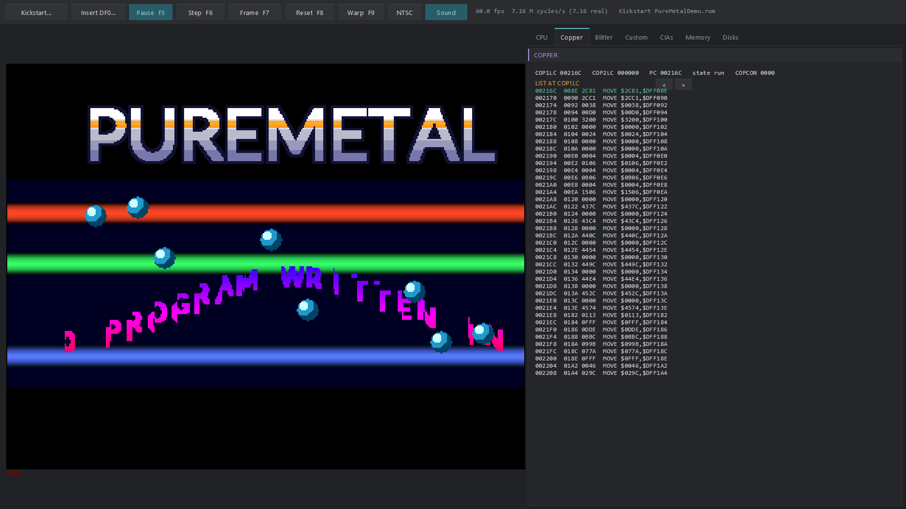
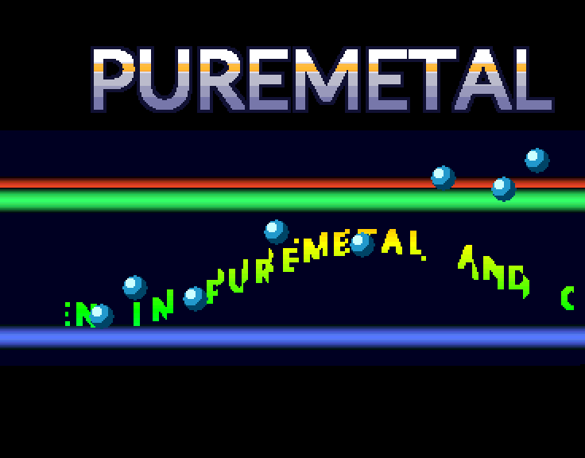

# Amiga 500 for the Raspberry Pi Pico series and the desktop

A Commodore Amiga 500 emulator (68000, OCS chipset) that runs on the RP2350
boards with PSRAM and on a Windows PC, built from one source tree. The 68000
core is new, generated for each target, and checked against the published
SingleStepTests 680x0 suite. The chipset is complete: Agnus with its copper
and blitter, Denise, Paula with audio and disk DMA, the two CIAs, the floppy
drives, the keyboard, mouse and joystick. On the Pico it is written in
PureMetal and compiled to bare-metal Thumb-2 by PureMetal Forge, with no SDK
and no RTOS. On the PC it is PureBasic, drawn with the Neon Arcade Display
Engine.

The emulated machine is the **US (NTSC) A500 by default**: 60 frames a second,
262/263 lines, a 3,579,545 Hz colour clock. The European **PAL** machine (50 Hz,
312/313 lines, 3,546,895 Hz) is one switch away.

**No Kickstart ROM, AROS image or commercial disk is included.** The
repository holds only its own code, the emulator's own boot ROM and a demo
written in PureMetal. See [ROMs and disks](#roms-and-disks) for where to get
system software legally.



## Features

- **68000** with exact instruction timings, address errors and every
  exception frame. On the PC it matches 990,590 of the 1,000,060 SingleStepTests
  680x0 tests in state and cycles; the board result is the same (see
  [Testing](#testing)).
- **Copper** (MOVE, WAIT, SKIP, danger bit) and **blitter** (area mode with
  shifts, masks, descending mode and fill; line mode; BBUSY and the BLIT
  interrupt), timed against the beam.
- **Denise**: bitplanes drawn by catch-up, so mid-line register changes land
  where they happen. HAM, EHB and dual playfield are supported, as are
  sprites with attach and priority.
- **Paula**: four audio channels (DMA and CPU) and disk DMA with WORDSYNC.
  The `.ADF` tracks are built as real MFM and written back.
- **CIAs**: timers, TOD, the serial port, the keyboard handshake and the drive
  lines.
- **NTSC or PAL**, chosen at start-up or switched at any time.
- **Both cores of the RP2350 at work**: core 0 runs the machine and core 1 mixes
  Paula's output. With a speaker, core 1 also streams it over Bluetooth A2DP.
- A **built-in boot ROM** that starts a bootable floppy with no Kickstart,
  enough for disks that take the machine over (demos, many games).
- **Deterministic**: a board and the PC produce the same chip RAM and the same
  audio, byte for byte. Every speed-up was proven that way.

## Supported boards

An A500 needs 512 KB of chip RAM, 512 KB of slow RAM and a 256 KB ROM. Only
the RP2350 boards with PSRAM have that much memory:

| Board | Chip | Memory | Status |
|---|---|---|---|
| Adafruit Feather RP2350 HSTX | RP2350A, 150 MHz | 520 KB SRAM + 8 MB PSRAM | runs at full speed, tested |
| Pimoroni Pico Plus 2 W | RP2350B, 150 MHz | 520 KB SRAM + 8 MB PSRAM, Bluetooth | runs at full speed, tested; Bluetooth sound built in |
| Raspberry Pi Pico 2 W | RP2350 | 520 KB SRAM | the 68000 core and its tests only; a whole machine does not fit |
| Raspberry Pi Pico W | RP2040 | 264 KB SRAM | the 68000 core and its tests only |

The Pico builds are headless: the Amiga's serial port and the machine's status
come out on USB serial, and a picture can be read back on request. The program
runs from SRAM. Chip and slow RAM live in PSRAM; on the Feather the low
256 KB of chip RAM is in SRAM. The Kickstart and the disk in DF0 are read from
flash.

## Performance

Measured at 150 MHz, NTSC, over 30 seconds. The machine is paced to a real
A500's frame (16,678 µs NTSC, 20,032 µs PAL). "Unpaced" is how fast it can run.
"Slowest frame" is the longest one frame of emulation took.

| Board | Program | Paced fps | Unpaced fps | Slowest frame | Late frames | Busy: core 0 / core 1 |
|---|---|---|---|---|---|---|
| Feather RP2350 | the PureMetal demo | **59.9** | 64.2 | 15.7 ms | 0 | 93% / 13% |
| Feather RP2350 | `tests/chiptest.rom` | **59.9** | 78.3 | 12.8 ms | 1, at start-up | |
| Pico Plus 2 W | the PureMetal demo | **59.9** | 62.6 | 16.3 ms | 0 | 95% / 13% |

What made it fast. Each change was checked against the PC's chip RAM and audio
before it was kept:

- **Thumb-2 fast paths** at the top of the busiest 68000 handlers: MOVE,
  MOVEA, CMP, BTST, Bcc/BRA, RTS, JSR, SWAP, EXT, CLR and ADD/AND to memory.
  Any unusual case falls back to the full handler, so every rule still holds.
- **A Thumb-2 blitter** for area blits: the demo's 2,682 words a frame went
  from 5.1 ms to 1.6 ms.
- **A Thumb-2 copper** and a computed same-line WAIT: 3.2 ms to 2.2 ms.
- **Paula split across the cores.** Core 0 steps the channels (every DMA fetch
  and interrupt on its line) and writes a small record per line. Core 1 turns
  the records into samples. Core 1 sleeps on `wfe` between records, because a
  spinning core 1 took memory cycles from core 0. Under NTSC this is what
  keeps the Pico Plus 2 W at full speed: its slowest frame went from 17.2 ms to
  16.3 ms.

On the PC the console runner does the demo at about 27 times real time.

## Quick start (Pico)

You need PureMetal Forge (the PureMetal compiler, which also uploads to the
board), Python 3, and a Kickstart ROM image you are
entitled to use (see [ROMs and disks](#roms-and-disks)).

1. **Prepare the Kickstart** (and, if you like, a disk) for the board's flash:

   ```
   py -3 tools/pico_media.py kick kickstart.rom build/kick.bin
   py -3 tools/pico_media.py adf  disk.adf      build/df0.bin
   ```

2. **Write them to the board's flash regions** (board connected by USB):

   | Board | Kickstart | DF0 | Extended ROM ($E00000) |
   |---|---|---|---|
   | Feather RP2350 | `$040000` | `$0C0000` | `$1A0000` |
   | Pico Plus 2 W | `$800000` | `$880000` | `$980000` |

   ```
   PureMetalForge.exe --storage-write build/kick.bin --offset $040000 -t rp2350 --port COM5
   PureMetalForge.exe --storage-write build/df0.bin  --offset $0C0000 -t rp2350 --port COM5
   ```

   The extended-ROM region is only needed for a ROM pair such as AROS's. Its
   first word erased (`$FFFFFFFF`) means none: when changing from such a pair
   to a plain Kickstart, write a 4 KB file of `$FF` bytes there.

3. **Build and upload the firmware:**

   ```
   PureMetalForge.exe --compile src/amiga.feather2350 -o build/amiga.uf2 --port COM5
   PureMetalForge.exe --compile src/amiga.picoplus2w  -o build/amiga.uf2 --port COM5
   ```

   Without `--port`, copy `build/amiga.uf2` to the board yourself: hold BOOTSEL
   while plugging it in, then drag the file onto the drive that appears.

4. **Talk to it** with any serial terminal on the board's USB port. It prints
   `READY`, then a status line every two seconds: frames per second, the
   emulated CPU speed, the slowest frame and each core's busy share.

`tools/pico_machine.ps1` does all four steps in one command and captures the
output:

```
powershell -File tools\pico_machine.ps1 -Port COM5 -Board feather2350 -Rom kickstart.rom -Adf disk.adf -Seconds 30
powershell -File tools\pico_machine.ps1 -Port COM5 -Board picoplus2w -Rom demo\PureMetalDemo.rom -Shot demo.png
```

### Commands on USB serial

| Key | Action |
|---|---|
| `s` | send the next picture (hex, one line per Amiga line); `pico_machine.ps1 -Shot` saves it as a PNG |
| `r` | reset the Amiga |
| `v` | switch between NTSC and PAL (with a reset) |
| `k` + 2 hex digits | press and release a key (Amiga raw key code) |
| `m` + dx dy | move the mouse (signed bytes, hex) |
| `f` | run unpaced, as fast as it goes |
| `d` + 4 hex digits | after that frame, dump chip RAM, slow RAM and the audio ring |
| `t` + 4 hex digits | a state hash of every line for three frames (comparison with the PC) |

### Choosing NTSC or PAL on the Pico

`#AMIGA_NTSC = 1` in the board's wrapper (`src/amiga.feather2350`,
`src/amiga.picoplus2w`) starts the US machine; set it to 0 for PAL. The `v`
command switches while it runs.

### Sound (Pico Plus 2 W)

Paula is mixed to mono 48 kHz and sent to a Bluetooth A2DP speaker. The
published wrapper has no speaker address and runs silent. For sound:

1. Copy `src/amiga.picoplus2w` outside the repository.
2. Put your speaker's address in its `Speaker` data, as a phone shows it:
   `AA:BB:CC:DD:EE:FF` becomes `Data.a $AA,$BB,$CC,$DD,$EE,$FF`.
3. Include `amiga_pico.pmi` in the copy by its absolute path, and build it.

The radio firmware must be in flash at `$200000`; the program checks for it
and says so. The link key is kept at `$960000`.

## ROMs and disks

The Amiga's system software is not free software, and none of it is in this
repository, in any commit. To run more than the included demo you need one of:

- **Kickstart 1.2 or 1.3** (the A500's own ROMs, 256 KB). Read them from your
  own Amiga with a ROM-dumping tool, or buy them in a licensed package such as
  [Amiga Forever](https://www.amigaforever.com/). Encrypted
  `rom.key` images are not supported; use a plain 262,144- or 524,288-byte
  image.
- **AROS**, the open-source AmigaOS-compatible system, from
  [aros.org](https://aros.org/) under the AROS Public License. Use its
  Kickstart-replacement ROM pair from the m68k boot ISO: `aros-rom.bin` at
  `$F80000` (the Kickstart region) and `aros-ext.bin` at `$E00000` (the
  extended-ROM region). The pair needs no extra RAM. The `aros.rom` loaded by
  AROSBootstrap needs 1.45 MB, more than an A500 has.
- **Disks** (`.ADF`): copies of floppies you own, or software whose authors
  allow free distribution.

```
desktop\amiga.exe --rom kick13.rom --adf workbench.adf
desktop\amiga.exe --rom aros-rom.bin --ext aros-ext.bin --adf bootdisk-amiga-m68k.adf
```

A single 1 MB file passed to `--rom` is split into the extended ROM and the
ROM.

With its boot floppy AROS reaches its shell window, then asks for the "AROS
Live CD" volume (the floppy is meant to go with the CD, and an A500 has none).
Under NTSC it opens a 200-line screen. On the Feather, AROS's chip and slow RAM
match the PC byte for byte at frame 1500, 25 seconds in.

### No Kickstart: the built-in boot ROM

`bootrom/bootrom.s` is the emulator's own boot ROM, written for this project
and assembled by `tools/asm68k.py` into `bootrom/bootrom.rom`. It is the one
ROM image in the repository and holds no Commodore code. It does what
Kickstart's strap does for a disk that takes the machine over:

- it reads DF0's bootblock by disk DMA;
- it checks for `DOS` and the checksum;
- it enters the bootblock with a trackdisk request and a small ExecBase.

The ExecBase answers AllocMem/FreeMem, DoIO and its relatives (read and
motor), Forbid/Permit and Disable/Enable. Anything else stops loudly, on serial
and with a red screen, naming the call. The desktop programs use it when no
Kickstart is given:

```
desktop\amiga_cli.exe --boot demo\PureMetalDemo.adf --frames 500 --shot demo.png
```

### The PureMetal demo (`demo/`)

An Amiga demo written entirely in PureMetal and compiled for the 68000 by
PureMetal Forge, with no assembly. It has a shaded three-bitplane logo, copper
bars, a sine scroller cut by the blitter, eight hardware sprites and a
four-channel tune. It builds into a bootable `.adf` and a stand-alone 256 KB
`.rom` that needs no Kickstart. See [demo/README.md](demo/README.md).



## The desktop program

### Building the desktop version

Windows, x64, with [PureBasic](https://www.purebasic.com/) 6.41 (x64, C back
end). The window program draws with the
[Neon Arcade Display Engine](https://github.com/ajtaji/Neon-Arcade-Dispay-Engine);
clone it beside this repository:

```
git clone https://github.com/ajtaji/AmigaEmulatorPicoSeries.git
git clone https://github.com/ajtaji/Neon-Arcade-Dispay-Engine.git
cd AmigaEmulatorPicoSeries
"C:\Program Files\PureBasic\Compilers\pbcompilerc.exe" desktop\amiga.pb /OPTIMIZER /THREAD /DPIAWARE /EXE desktop\amiga.exe
"C:\Program Files\PureBasic\Compilers\pbcompilerc.exe" desktop\amiga_cli.pb /CONSOLE /OPTIMIZER /THREAD /EXE desktop\amiga_cli.exe
desktop\amiga.exe --adf demo\PureMetalDemo.adf
```

With no Kickstart the window program uses its built-in boot ROM, which boots
the demo's floppy; a Kickstart or disk can also be chosen in its Disks pane.
The demo's `.adf` and `.rom` are in the repository, built by PureMetal Forge
from `demo/demo.amiga` (see [demo/README.md](demo/README.md)). To use an engine somewhere else, add
`/CONSTANT GL_ENGINE_DIR$=<its folder>/` (with the trailing slash). From Git
Bash, `desktop/build.sh amiga` and `desktop/build.sh amiga_cli console` do the
same, taking the engine's folder from `NEON_ENGINE_DIR` (`tools/env.sh`).

### Running it

```
desktop\amiga.exe --rom <kickstart> [--ext <extended rom>] [--adf disk.adf] [--df1 disk.adf] [--pal] [--mute]
desktop\amiga_cli.exe --rom <kickstart> [--adf disk.adf] [--frames N] [--shot pic.png] [--pal]
```

The window shows the picture with the power and drive LEDs. Beside it are
panes for the CPU (registers, disassembly, the 68000 test suite), Copper,
Blitter, Custom registers, CIAs, Memory and Disks (Kickstart, DF0/DF1, a
folder of `.ADF` files).

### Controls

| Input | Amiga |
|---|---|
| PC keyboard | Amiga keyboard (Windows keys = Amiga keys, Insert = Help) |
| Mouse over the picture | Amiga mouse in port 1 |
| Numeric pad 8 4 6 2, 0 = fire, or a gamepad | joystick in port 2 |
| F5 / F6 / F7 | run or pause / one instruction / one frame |
| F8 | reset |
| F9 | warp (as fast as it goes) |
| F11 | full screen |
| NTSC/PAL button | switch the standard (a power cycle) |

`amiga_cli` runs without a window. It prints what the Amiga sent on its
serial port and where the CPU is, and can save the last picture. `--dump-chip
<file>` saves chip RAM, slow RAM and the audio ring for comparison with a
board.

## Building from source

| Part | Tool | Command |
|---|---|---|
| The 68000 cores (`src/m68k.pico`, `src/m68k.pico2`, `desktop/m68k_core.pbi`) | Python 3 | `py -3 tools/gen_m68k.py` (generated files are committed) |
| Pico firmware | PureMetal Forge (2026-10-25 or later: Thumb-2 inline assembly) | `PureMetalForge.exe --compile src/amiga.feather2350 -o build/amiga.uf2` |
| Desktop programs | PureBasic 6 x64, Neon engine | `desktop/build.sh amiga` |
| Boot ROM, test ROMs | Python 3 | `py -3 tools/asm68k.py bootrom/bootrom.s bootrom/bootrom.rom` |
| The demo | PureMetal Forge | `PureMetalForge.exe --compile demo/demo.amiga -o demo/PureMetalDemo.bin` |

The scripts find the compiler through `PUREMETAL_FORGE` (or the PATH), the
Neon engine through `NEON_ENGINE_DIR`, and the 68000 tests through
`SST_680X0_DIR`. `tools/env.ps1` and `tools/env.sh` give the defaults. Put your
own paths in `tools/local.ps1` or `tools/local.sh`; git ignores both.

## Testing

**The 68000 core** is checked against
[SingleStepTests 680x0](https://github.com/SingleStepTests/680x0) (68000/v1,
1,000,060 tests, MIT licensed, not included). Download it, then:

```
py -3 tools/vectors.py <the suite's 68000/v1 folder> tests/680x0/compact
desktop/run_check.sh                  # the whole suite on the PC
desktop/run_check.sh ADD              # the groups whose names start with ADD
```

The same runner (`Diagnostics/vectors_run.pmi`) judges every register, the
status register, the PC, both stack pointers, every named byte and the cycle
count, on the PC and on a board.

| Where | Exact (state and cycles) | Suite errata | Fail |
|---|---|---|---|
| PC | 990,590 | 9,469 | 1 |
| Pico 2 W (RP2350, 150 MHz), all 124 groups | 990,590 | 9,469 | 1 |

The suite was generated by an emulator rather than recorded on a 68000. Where it
disagrees with cores verified on real hardware (UAE's cputester results,
Moira, Musashi), the runner applies the hardware behaviour and counts the test
as an erratum, never as a pass. The cases are: ASR of a negative value by more
than its width (X = C = 1), DIVU/DIVS overflow flags (N = 1, Z = 0), two ASL.b
results, the cycle count of ADDQ/SUBQ.L to an address register, and overflowing
DIVS timing. The single failure is DIVU test 5744, a divide by zero whose stacked
PC differs from every other such test in the suite.

**The chipset** has test ROMs that need no Kickstart (`tests/*.s`, assembled
by `tools/asm68k.py`):

| ROM | What it proves |
|---|---|
| `chiptest.s` | copper list, bitplane DMA and the display window, blitter fill, XOR, lines and area fill, sprites, the serial port |
| `disktest.s` | the drive through CIA-B (motor, step to track 0), disk DMA after the sync word, a sector decoded by 68000 code matching the `.ADF` |
| `irqtest.s` | VERTB interrupts, CIA-A timer A at 100 Hz, the keyboard handshake |
| `audiotest.s` | Paula DMA at a known pitch, the period floor, audio interrupts |
| `bench.s` | instruction throughput (25.7 M 68000 instructions/s on the PC) |

`tools/mfm_check.py` decodes a track independently of the emulator.

**Board against PC.** The machine is deterministic, so a board must produce
exactly what the PC produces. Two scripts check that:

- `tools/pico_demo_check.sh [rom] [port] [board]` runs a program on both and
  compares chip RAM after frame 1000 and Paula's last 4,096 samples.
- `tools/pico_compare.sh <frame> <rom> [ext] [adf] [port] [board]` compares
  chip and slow RAM at any frame, with any Kickstart, ROM pair and disk.

Results:

- The demo: identical on the Feather and the Pico Plus 2 W under NTSC, and on
  the Feather under PAL.
- AROS (ROM pair and boot floppy): identical on the Feather at frame 1500,
  under NTSC and under PAL. When they differ, `amiga_cli --trace` and the board's `t` command give a
hash of every line, so the first differing line can be found. An instruction
trace of that line then shows the cause.

## Known limits

- **Headless on the Pico**: no video output yet. The picture is read back over
  USB.
- **Every NTSC line is 227 colour clocks.** A real NTSC Agnus alternates 227
  and 228, so the emulated frame rate is 59.96 Hz rather than 59.94.
- **OCS only**: ECS and AGA registers ($1C0 and up) are ignored, as on an OCS
  machine. There is no fast RAM, no hard disk and no second CPU.
- **Programs written for PAL** lose their bottom lines under NTSC, as on a real
  US machine. The demo's scroller, drawn while the beam is on screen, tears in
  some frames under NTSC.
- **Bluetooth sound** on the Pico Plus 2 W is built, but has not yet been
  heard on a speaker.
- **Commodore's Kickstart** has not been booted here: the test bench has no
  image of it. The chipset follows the hardware reference and runs AROS,
  whose ROM drives the same hardware, but Kickstart 1.3 and Workbench are
  untested.
- **Kickstart `rom.key` images** (Amiga Forever's encrypted ROMs) are not
  supported.

## Repository layout

| Path | What |
|---|---|
| `amiga/` | the chipset and the machine, one source for PureMetal and PureBasic |
| `src/` | the Pico program, the board wrappers and the Thumb-2 parts (`*_fast.pmi`) |
| `desktop/` | the window program, the console runner and the 68000 checker |
| `tools/` | the core generator, the 68000 assembler, the media and board tools |
| `bootrom/` | the emulator's own boot ROM |
| `tests/` | the chipset test ROMs (source) and the boot-disk test |
| `demo/` | the PureMetal demo |
| `Diagnostics/` | the 68000 test runner and its board builds |
| `docs/` | screenshots and the board test logs |

## Licence

MIT, `Copyright (c) 2026 ajtaji` (see [LICENSE](LICENSE)).

Third-party material:

- The demo's logo and scroller are rendered from **Lato**, under the SIL Open
  Font License 1.1 ([demo/fonts/OFL.txt](demo/fonts/OFL.txt)).
- The 68000 tests are **SingleStepTests 680x0** (MIT). They are downloaded by
  the user, not included.
- The desktop program builds against the **Neon Arcade Display Engine**, a
  separate repository under its own licence.

Amiga, AmigaOS and Kickstart are trademarks of their owners. This project is
not affiliated with them.
